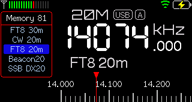
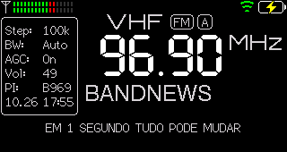
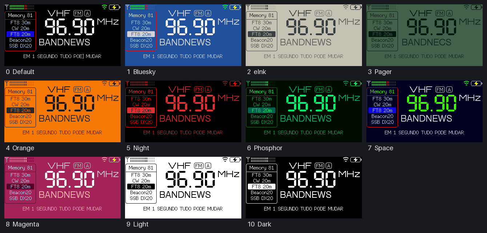

# ATS-Mini — edição PU2QTF

Firmware personalizado para o receptor **ATS-Mini (ESP32-S3 + SI4732)**, baseado no
[firmware oficial ATS Mini](https://github.com/esp32-si4732/ats-mini) v2.45 e montado
para um shack de escuta de radioamador em São Bernardo do Campo/SP (grid GG66rh).


*English summary: a personal fork of the ATS Mini firmware with an animated CQ-in-CW
boot screen, live NCDXF/IARU beacon identification, remote EiBi download/diagnostics,
a macOS/Linux USB control tool and a ready-made memory set for São Paulo, Brazil.*

## O que esta edição acrescenta

| Recurso | Descrição |
|---|---|
| **Abertura PU2QTF** | Ao ligar, "CQ CQ CQ DE PU2QTF K" é transmitido em CW *na tela*. As letras aparecem como num decodificador, os pontos e traços acendem, uma cascata (waterfall) mostra o sinal e uma faixa de mensagem passa embaixo. Clique no knob para pular. |
| **Beacons NCDXF/IARU ao vivo** | Em 14100, 18110, 21150, 24930 e 28200 kHz o rádio mostra qual dos 18 beacons está no ar naquele instante (ex.: `Beacon LU4AA Buenos Aires`), calculado pelo relógio UTC. |
| **EiBi pelo USB** | O comando remoto `J` baixa a programação mundial de ondas curtas e informa o resultado; `?` mostra o status do relógio e da EiBi. |
| **Atualização pelo Wi-Fi a partir deste fork** | *Settings → Update FW* busca as versões deste repositório, então atualizar não apaga a personalização. |
| **Ferramenta `ats-mini`** | Controle pelo USB a partir do Mac/Linux: status, sintonia, varredura de FM/AM/ondas curtas com medição de sinal, gravação de memórias e screenshots. |
| **Memórias prontas** | 96 memórias: FM e AM da Grande SP medidas no local, ondas curtas e 26 frequências de radioamador (CW, FT8, SSB, beacons, SSTV, WWV). |

Todo o resto é o firmware oficial: FM com RDS, AM, SSB, ondas curtas, EiBi, Wi-Fi,
memórias, temas etc. Veja o [manual oficial](https://esp32-si4732.github.io/ats-mini/manual.html).

## Telas

| | |
|---|---|
|  |  |
| Beacon NCDXF identificado ao vivo em 20 m | Memórias de radioamador |
|  |  |
| Ondas curtas com o nome vindo da EiBi | FM com RDS (nome e texto) |

Temas disponíveis (*Settings → Theme* ou página *Config* pelo Wi-Fi):



## Começando

1. **Instalar:** [pu2qtf/docs/instalacao.md](pu2qtf/docs/instalacao.md). Gravação pelo navegador, pela linha de comando ou pelo Wi-Fi.
2. **Usar:** [pu2qtf/docs/uso.md](pu2qtf/docs/uso.md). Recursos, comandos remotos, ferramenta `ats-mini` e memórias.
3. **Desenvolver e evoluir:** [pu2qtf/docs/desenvolvimento.md](pu2qtf/docs/desenvolvimento.md). Compilar, testar, trocar o indicativo, acompanhar o firmware oficial e publicar versões.
4. **Experimento de áudio por RF:** [pu2qtf/docs/experimento-audio-rf.md](pu2qtf/docs/experimento-audio-rf.md). Por que a abertura é silenciosa.

## Organização do repositório

```
ats-mini/            firmware (Arduino). Arquivos novos: Intro.cpp / Intro.h
changelog/           fragmentos de changelog (towncrier) das mudanças desta edição
docs/                documentação oficial (Sphinx)
pu2qtf/
  docs/              documentação desta edição (pt-BR)
  tools/ats-mini     ferramenta de controle pelo USB
  memorias/          memórias prontas e pesquisa de estações de São Bernardo do Campo
  scans/             varreduras de FM, AM e ondas curtas medidas no local
  screenshots/       telas capturadas do rádio
```

## Créditos e licença

Firmware oficial ATS Mini: <https://github.com/esp32-si4732/ats-mini>. Ele é baseado em:

* Volos Projects: https://github.com/VolosR/TEmbedFMRadio
* PU2CLR, Ricardo: https://github.com/pu2clr/SI4735
* Ralph Xavier: https://github.com/ralphxavier/SI4735
* Goshante: https://github.com/goshante/ats20_ats_ex
* G8PTN, Dave: https://github.com/G8PTN/ATS_MINI

Licença [MIT](LICENSE), mantida neste fork. Personalização PU2QTF por Fernando. 73!
