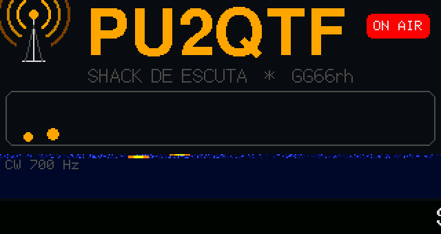
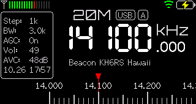
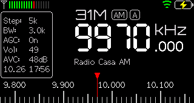

# Uso

Este guia cobre só o que a edição PU2QTF acrescenta. Para todo o resto (menus, bandas,
SSB, Wi-Fi, temas), veja o [manual oficial](https://esp32-si4732.github.io/ats-mini/manual.html).

## Abertura PU2QTF

Ao ligar o rádio:

1. Quatro "notas" acendem e a lâmpada **ON AIR** pisca.
2. `CQ CQ CQ DE PU2QTF K` é enviado em CW a 25 WPM. Cada letra aparece no "decodificador",
   os pontos e traços da letra atual acendem, a antena irradia e a cascata mostra o
   traço do sinal em 700 Hz.
3. Uma faixa embaixo passa a mensagem do shack.
4. A tela `73! de PU2QTF` fecha a abertura (cerca de 10 s no total).

**Clique no knob** para pular. Para ver de novo sem desligar: `ats-mini intro` (comando remoto `Q`).

A abertura é visual: o rádio não tem caminho de áudio do processador para o alto-falante.
Veja [experimento-audio-rf.md](experimento-audio-rf.md).

## Beacons NCDXF/IARU ao vivo

O [International Beacon Project](https://www.ncdxf.org/beacon/) tem 18 beacons
espalhados pelo mundo. Cada um transmite 10 s por vez, num ciclo de 3 minutos
sincronizado com o UTC, passando por 14100, 18110, 21150, 24930 e 28200 kHz.

Sintonize uma dessas frequências (memórias `Beacon20`, `Beacon17`, `Beacon15`, `Beacon12`
e `Beacon10`) e o rádio mostra **quem está transmitindo agora**, atualizando a cada
2 segundos. Se você ouve o beacon, a propagação para aquela região está aberta naquela banda.

Requer o relógio acertado (Wi-Fi, *Settings → Date/Time* ou a página *Config*).

| # | Beacon | Local | # | Beacon | Local |
|---|---|---|---|---|---|
| 1 | 4U1UN | Nova York (ONU) | 10 | 4S7B | Sri Lanka |
| 2 | VE8AT | Nunavut, Canadá | 11 | ZS6DN | África do Sul |
| 3 | W6WX | Califórnia | 12 | 5Z4B | Quênia |
| 4 | KH6RS | Havaí | 13 | 4X6TU | Israel |
| 5 | ZL6B | Nova Zelândia | 14 | OH2B | Finlândia |
| 6 | VK6RBP | Austrália | 15 | CS3B | Madeira |
| 7 | JA2IGY | Japão | 16 | LU4AA | Buenos Aires |
| 8 | RR9O | Sibéria | 17 | OA4B | Lima |
| 9 | VR2B | Hong Kong | 18 | YV5B | Caracas |

## Programação EiBi (nomes em ondas curtas)

Com a programação [EiBi](http://eibispace.de/) carregada, o rádio mostra o nome da
emissora que está no ar em cada frequência de ondas curtas. Para carregar (precisa de Wi-Fi
com internet):

- no rádio: *Settings → Load EiBi*;
- pelo USB: `ats-mini eibi`, que informa o resultado, por exemplo
  `EiBi load: OK: 619225 of 619225 bytes, 8015 entries`.

Para conferir: `ats-mini info`. Atualize no início de cada temporada (fim de março e fim de outubro).

## Atualização pelo Wi-Fi

*Settings → Update FW* (ou a página **Update**) procura a última release de
<https://github.com/fernandofatech/ats-mini-pu2qtf>. Como a release desta edição tem o mesmo
número da versão oficial em que se baseia, o rádio só vê "versão nova" quando o fork for
atualizado para uma nova versão oficial. Veja [desenvolvimento.md](desenvolvimento.md#acompanhar-o-firmware-oficial).

## Comandos remotos novos

Valem pela USB (*Settings → USB Port → Ad hoc*), TCP ou Bluetooth, junto com os
[comandos oficiais](https://esp32-si4732.github.io/ats-mini/remote.html):

| Tecla | Função |
|---|---|
| `Q` | Toca a abertura PU2QTF |
| `?` | Mostra o status do relógio e da EiBi (arquivo, entradas, resultado do último download) |
| `J` | Baixa a programação EiBi e informa o resultado |
| `c` / `C` | (oficial) Screenshot; nesta edição também funciona *durante* a abertura |

## Ferramenta `ats-mini` (macOS/Linux)

[`pu2qtf/tools/ats-mini`](../tools/ats-mini) é um script Python que roda com o
[uv](https://docs.astral.sh/uv/) e instala sozinho a dependência (`pyserial`). Copie para
algum lugar no `PATH` (ex.: `~/bin`) e use:

| Comando | O que faz |
|---|---|
| `ats-mini status` / `monitor` | Frequência, banda, modo, RSSI, SNR, volume e bateria (uma vez / ao vivo) |
| `ats-mini tune 96.9` · `tune 840k` · `tune 14074k usb` | Sintoniza e troca de banda automaticamente (FM em MHz; AM/SSB em kHz) |
| `ats-mini scan-fm` | Varre 76,1–107,9 MHz (inclui FM estendido) e mede cada canal |
| `ats-mini scan-am` | Varre 530–1700 kHz em passos de 10 kHz |
| `ats-mini scan-sw` | Varre as faixas de radiodifusão de 120 m a 11 m em passos de 5 kHz |
| `ats-mini scan 3500k 3800k 1k` | Varre qualquer faixa |
| `ats-mini mem-dump [arq.csv]` · `mem-load arq.csv` · `mem-clear` | Exporta, grava e apaga as 99 memórias |
| `ats-mini screenshot [tela.bmp]` | Captura a tela |
| `ats-mini intro` · `info` · `eibi` | Comandos desta edição (acima) |
| `ats-mini send "VVV"` | Envia comandos brutos (ex.: volume +3) |

As varreduras gravam um CSV com RSSI e SNR de cada frequência e listam no fim os canais com
sinal útil. Faça a varredura de ondas curtas à noite, com a antena perto da janela.

## Memórias prontas

[`pu2qtf/memorias/memorias-pu2qtf.csv`](../memorias/memorias-pu2qtf.csv) tem 96 memórias
para São Bernardo do Campo/SP:

| Memórias | Conteúdo |
|---|---|
| 01–40 | FM com sinal bom ou ótimo medido no local (inclui FM estendido 76–88 MHz) |
| 41–53 | AM da Grande SP (várias só à noite) e Nacional Brasília/Rio à noite |
| 54–70 | Ondas curtas: Nacional da Amazônia, Brasil Central, Inconfidência, Habana Cuba, REE, WRMI… |
| 71–94 | Radioamador: CW, FT8 e SSB de 80 a 10 m, beacons NCDXF, SSTV |
| 95–96 | Sinais horários WWV em 10 e 15 MHz |

Para gravar: `ats-mini mem-load pu2qtf/memorias/memorias-pu2qtf.csv`. Para usar em outra
cidade, rode `ats-mini scan-fm`, ajuste o CSV e grave. O arquivo
[`estacoes-pesquisa.csv`](../memorias/estacoes-pesquisa.csv) traz a pesquisa completa,
com fontes e grau de confiança.

## Dicas de UX

- **Tema:** os 11 temas estão em [screenshots/temas.png](../screenshots/temas.png).
  *Phosphor* e *Space* combinam com a abertura.
- **S-Meter grande:** *Settings → UI Layout → S-Meter*.
- **Zoom Menu:** menus com fonte maior (*Settings → Zoom Menu*).
- **Bateria:** *Sleep Timer* apaga a tela depois de alguns segundos; *Off Timer* desliga sozinho.
